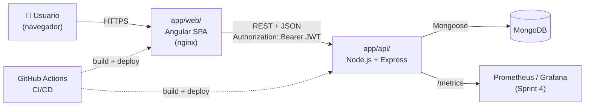
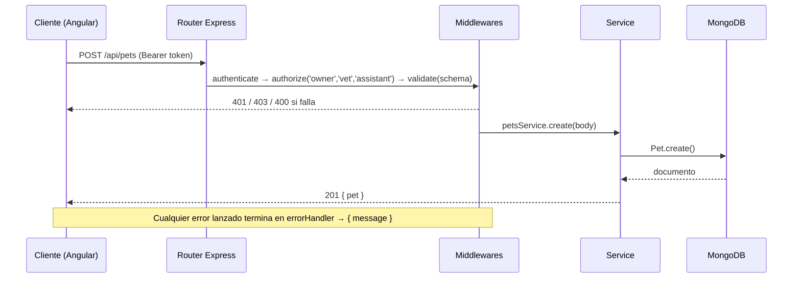

# 04 · Arquitectura

## Vista general

VetCare es una aplicación **MEAN** organizada como **monorepo**: la documentación vive en `docs/` y todo el código en `app/` (backend en `app/api/` y frontend en `app/web/`). Frontend y backend se construyen y despliegan por separado.



## Stack

| Capa | Tecnología | Por qué |
|---|---|---|
| Frontend | Angular (standalone, signals) + Angular Material | Es el framework del programa; Material nos da componentes accesibles listos |
| Backend | Node.js 22 + Express 5 | Express 5 maneja los errores de funciones `async` sin wrappers |
| Base de datos | MongoDB 7 + Mongoose | Ver [ADR-0001](./adr/0001-mongodb.md) |
| Validación | zod | Esquemas declarativos y mensajes claros |
| Autenticación | JWT + bcrypt | Ver [ADR-0002](./adr/0002-jwt.md) |
| Tests API | Jest + supertest + mongodb-memory-server | Tests de integración sin necesitar Mongo real |
| Tests web | Vitest (unitarios) + Playwright (e2e) | Son los que trae el Angular CLI actual |
| Contenedores | Docker + docker-compose | Mismo entorno en desarrollo, CI y producción |
| CI/CD | GitHub Actions | Integrado con el repo y gratis para repos públicos |
| Despliegue | Railway (API + web) + MongoDB Atlas | Capa gratuita y despliegue desde GitHub |
| Observabilidad | prom-client + pino | Métricas en formato Prometheus y logs en JSON |

## Arquitectura del backend: módulos por dominio

Cada dominio tiene su propia carpeta con **rutas → controlador → servicio → modelo**. Así cada integrante del equipo puede trabajar en un módulo sin pisar a los demás.

```
app/api/src/
├── config/          # env.js (valida variables), db.js (conexión)
├── middlewares/     # authenticate, authorize, validate, errorHandler
├── utils/           # AppError, logger
├── modules/
│   ├── auth/        # login, register, me
│   ├── users/       # personal de la clínica + modelo User
│   ├── clients/     # tutores (usuarios con rol client)
│   ├── pets/        # pacientes
│   ├── appointments/
│   ├── records/     # consultas (historia clínica)
│   └── vaccinations/
├── app.js           # crea la app de Express (sin listen → testeable)
└── server.js        # conecta a la base de datos y llama a listen
```

| Capa | Responsabilidad | No debe |
|---|---|---|
| `*.routes.js` | Definir el verbo y la URL, aplicar middlewares (auth, roles, validate) | Tener lógica de negocio |
| `*.controller.js` | Leer `req` y responder con `res` | Hablar directamente con Mongoose |
| `*.service.js` | Reglas de negocio (choques de agenda, permisos por dueño) | Conocer `req` y `res` |
| `*.model.js` | Esquema, validaciones e índices | — |

### Flujo de una petición



## Arquitectura del frontend

```
app/web/src/app/
├── core/         # AuthService, interceptores, guards, modelos (interfaces)
├── shared/       # componentes y pipes reutilizables
├── layout/       # shell con toolbar y sidenav según el rol
└── features/     # una carpeta por pantalla o dominio, cargadas con lazy loading
    ├── auth/  dashboard/  pets/  appointments/  records/  staff/  portal/
```

- **Componentes standalone** y **signals** para el estado.
- **Lazy loading** por feature (`loadComponent` y `loadChildren`).
- **`authInterceptor`**: agrega el token y, si recibe un 401, cierra la sesión.
- **`authGuard` y `roleGuard(...roles)`** protegen las rutas. Recordatorio: el frontend **oculta**, pero el backend es el que **protege**.

## Entornos

| Entorno | Base de datos | Cómo se levanta |
|---|---|---|
| Local | Mongo en Docker (`docker compose up -d` dentro de `app/`) | `npm run dev` en `app/api/` y `npm start` en `app/web/` |
| Test / CI | mongodb-memory-server | `npm test` |
| Producción | MongoDB Atlas | Railway, despliegue automático desde `main` |

## Decisiones de arquitectura (ADR)

- [ADR-0001 · MongoDB como base de datos](./adr/0001-mongodb.md)
- [ADR-0002 · Autenticación con JWT stateless](./adr/0002-jwt.md)
- [ADR-0003 · Monorepo](./adr/0003-monorepo.md)

> Cuando el equipo tome una decisión técnica importante, agrega un ADR nuevo copiando [`adr/plantilla.md`](./adr/plantilla.md).
