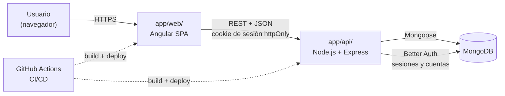
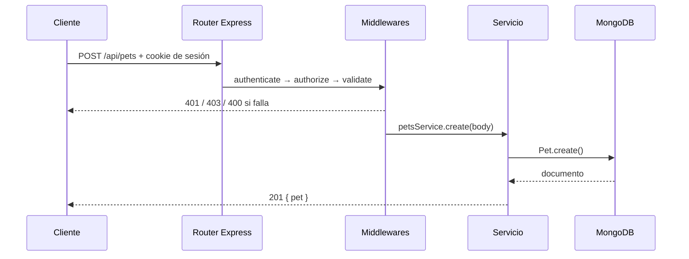

# 04 · Arquitectura

## Vista general

VetCare es una aplicación **MEAN** organizada como **monorepo**: la documentación vive en `docs/` y el código del backend en `app/api/`. Frontend y backend se construyen y despliegan por separado.



## Stack

| Capa | Tecnología | Por qué |
|---|---|---|
| Frontend | Angular (standalone, signals) + Angular Material | Framework del programa y componentes accesibles |
| Backend | Node.js 22 + Express 5 | API REST con manejo de errores async |
| Base de datos | MongoDB 7 + Mongoose | Ver [ADR-0001](./adr/0001-mongodb.md) |
| Autenticación | Better Auth + sesiones en cookies httpOnly + bcrypt | Ver [ADR-0002](./adr/0002-better-auth.md) |
| Validación | Zod | Esquemas declarativos para las rutas de dominio |
| Tests API | Jest + supertest + mongodb-memory-server | Pruebas de integración |
| Tests web | Vitest + Playwright | Pruebas unitarias y e2e |
| Contenedores | Docker + docker-compose | Entornos reproducibles |
| CI/CD | GitHub Actions | Integrado con el repositorio |
| Despliegue | Railway + MongoDB Atlas | Despliegue desde GitHub |
| Observabilidad | Prometheus + Grafana (planificado) | Métricas y dashboards |

## Arquitectura del backend: módulos por dominio

```text
app/api/src/
├── config/          # env.js, db.js y configuración de Better Auth
├── middlewares/     # authenticate, authorize, validate, errorHandler
├── utils/           # AppError, roles y validación compartida
├── modules/
│   ├── users/       # perfiles de personal + modelo User
│   ├── clients/     # tutores (usuarios con rol client)
│   └── pets/        # pacientes
│   ├── appointments/ # citas (planificado)
│   ├── records/      # historias clínicas (planificado)
│   └── vaccinations/ # vacunas (planificado)
├── app.js           # app de Express testeable
└── server.js        # conexión a la base de datos y listen
```

| Capa | Responsabilidad | No debe |
|---|---|---|
| Rutas | Definir URL, verbo y middlewares | Tener lógica de negocio |
| Controlador | Leer `req` y responder con `res` | Acceder directamente a Mongoose |
| Servicio | Aplicar reglas de negocio | Conocer `req` y `res` |
| Modelo | Esquema, validaciones e índices | — |

Better Auth maneja `/api/auth/*` antes de `express.json()` y guarda identidades, credenciales y sesiones en MongoDB. Los perfiles de VetCare siguen en Mongoose; el ObjectId es compartido con Better Auth para conservar las referencias de mascotas. `authenticate` valida la cookie y consulta el perfil actual para comprobar su rol y si sigue activo.

La autenticación usa `POST /api/auth/sign-up/email`, `POST /api/auth/sign-in/email`, `POST /api/auth/sign-out` y `GET /api/auth/get-session`. El cliente debe incluir credenciales en las llamadas cross-origin.

Las cuentas preexistentes se importan con `npm run auth:migrate` desde `app/api/`, antes de desplegar la nueva autenticación. La migración preserva IDs y hashes bcrypt.

### Flujo de una petición protegida



## Arquitectura del frontend

El frontend previsto se divide en `core/` (autenticación, interceptores, guards), `shared/`, `layout/` y `features/` (dashboard, mascotas, citas, historias clínicas y portal) con lazy loading.

- Componentes standalone y signals para el estado.
- Lazy loading por feature.
- El cliente debe enviar cookies con `withCredentials` o `credentials: "include"`.
- Los guards del frontend mejoran la navegación; el backend sigue siendo quien autoriza las operaciones.

## Entornos

| Entorno | Base de datos | Cómo se levanta |
|---|---|---|
| Local | Mongo en Docker (`docker compose up -d` dentro de `app/`) | `npm run dev` en `app/api/` |
| Test / CI | mongodb-memory-server | `npm test` |
| Producción | MongoDB Atlas | Configurar `MONGO_URI`, `BETTER_AUTH_SECRET`, `BETTER_AUTH_URL` y `CORS_ORIGIN` |

## Decisiones de arquitectura (ADR)

- [ADR-0001 · MongoDB como base de datos](./adr/0001-mongodb.md)
- [ADR-0002 · Autenticación con Better Auth](./adr/0002-better-auth.md)
- [ADR-0003 · Monorepo](./adr/0003-monorepo.md)

> Cuando el equipo tome una decisión técnica importante, agrega un ADR nuevo copiando [`adr/plantilla.md`](./adr/plantilla.md).
