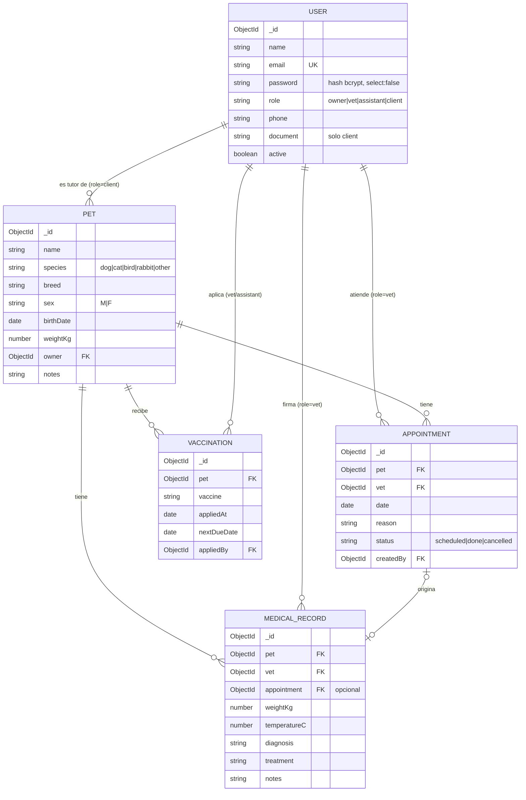

# 05 · Modelo de datos

## Diagrama

> Todas las colecciones usan `timestamps: true`, así que tienen `createdAt` y `updatedAt`.

## Decisiones de modelado

| Pregunta | Decisión | Razón |
|---|---|---|
| ¿Tutores en una colección aparte? | **No.** Son `User` con `role: 'client'` | El tutor inicia sesión en el portal, así que necesita credenciales |
| ¿Consultas embebidas en Pet? | **No.** Colección `medicalrecords` | Crecen sin límite (el límite de un documento es 16 MB) y se paginan y ordenan por fecha |
| ¿Vacunas embebidas en Pet? | **No.** Colección `vaccinations` | Necesitamos consultar "vacunas que vencen en 30 días" en todas las mascotas |
| ¿Borrar personal? | **Desactivar** (`active: false`) | Las consultas guardan la referencia al veterinario que las firmó |
| ¿`vet` de la consulta en el body? | **No.** Se toma de `req.user.id` | Así nadie puede firmar una consulta en nombre de otro |

## Índices

| Colección | Índice | Para qué |
|---|---|---|
| users | `{ email: 1 }` único | Login y evitar correos duplicados |
| users | `{ role: 1, active: 1 }` | Listar el personal activo |
| pets | `{ owner: 1 }` | Mascotas de un tutor y el portal del cliente |
| pets | `{ name: 'text' }` (opcional) | Búsqueda por nombre |
| appointments | `{ vet: 1, date: 1 }` | Agenda del día y validación de choques de horario |
| appointments | `{ pet: 1, date: -1 }` | Historial de citas de una mascota |
| medicalrecords | `{ pet: 1, createdAt: -1 }` | Línea de tiempo de la historia clínica |
| vaccinations | `{ nextDueDate: 1 }` | Vacunas por vencer |

## Datos de ejemplo (seed)

El script `npm run seed` (Sprint 1) crea:

- 1 dueño (`owner@vetcare.dev`), 2 veterinarios y 1 auxiliar
- 5 tutores con 1 o 2 mascotas cada uno
- Citas para hoy y para mañana
- Vacunas con vencimientos en los próximos 30 días, para probar el dashboard
