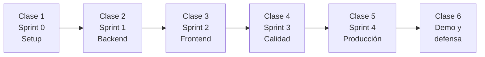

# 07 · Cómo trabajamos: Scrum adaptado

## Calendario

El proyecto dura **6 clases de 2 horas**, una por semana. Cada semana es un sprint.



| Clase | Sprint que **arranca** | Contenido técnico de la clase | Review de |
|:-:|---|---|---|
| 1 | Sprint 0 · Descubrimiento y setup | Requerimientos, historias, arquitectura, Git flow, Docker, CI | — |
| 2 | Sprint 1 · Backend core | Express por módulos, Mongoose, JWT, roles, zod, supertest | Sprint 0 |
| 3 | Sprint 2 · Frontend y agenda | Angular Material, guards, interceptor, formularios reactivos | Sprint 1 |
| 4 | Sprint 3 · Historia clínica y calidad | Tests unitarios, de integración y e2e; OWASP; índices | Sprint 2 |
| 5 | Sprint 4 · Producción | Docker multi-stage, Railway + Atlas, CD, métricas, logs | Sprint 3 |
| 6 | — | **Demo final, defensa técnica, portafolio y entrevistas** | Sprint 4 |

## Estructura de cada clase (120 min)

| Bloque | Tiempo | Qué pasa |
|---|:-:|---|
| 🔍 **Sprint review** | 15' | Cada equipo muestra en vivo lo que quedó en **Done** (sin diapositivas) |
| 🔄 **Retrospectiva** | 10' | Formato *Start / Stop / Continue* en el tablero |
| 🧑‍🏫 **Contenido técnico + live coding** | 60' | El docente construye la base del sprint y los equipos replican |
| 📋 **Sprint planning** | 25' | Elegir historias, dividirlas en tareas, asignar responsables y definir el objetivo del sprint |
| ❓ **Cierre** | 10' | Dudas y bloqueos |

> En la clase 1 no hay review ni retro: ese tiempo se usa para el kickoff del proyecto.

## Roles

| Rol Scrum | Quién | Responsabilidad |
|---|---|---|
| **Product Owner** | Docente | Prioriza el backlog, acepta o rechaza historias en la review |
| **Scrum Master** | Rota cada sprint dentro del equipo | Facilita la daily, actualiza el tablero, escala bloqueos |
| **Development Team** | 3 o 4 estudiantes | Construyen, revisan PRs y se autoorganizan |

## Ceremonias fuera de clase

- **Daily asíncrona** (todos los días, en el canal del equipo):
  ```
  ✅ Ayer: ...
  🎯 Hoy: ...
  🚧 Bloqueos: ...
  ```
- **Tutoría semanal**: el Scrum Master lleva los bloqueos del equipo.

## Tablero (GitHub Projects)

| Columna | Entra cuando... |
|---|---|
| **Backlog** | La historia existe |
| **Ready** | Cumple la Definition of Ready |
| **In progress** | Alguien la tomó y tiene una rama creada |
| **Review** | Hay un PR abierto |
| **Done** | Cumple la Definition of Done |

**Límite WIP:** máximo **1 historia en In progress por persona**.

## Definition of Ready (DoR)

Una historia puede entrar al sprint si:
- [ ] Tiene el formato *Como / Quiero / Para*
- [ ] Tiene criterios de aceptación verificables
- [ ] Está estimada en story points
- [ ] No depende de algo que no esté hecho
- [ ] Cabe en el sprint (máximo 5 SP; si es más grande, hay que dividirla)

## Definition of Done (DoD)

Una historia está terminada si:
- [ ] Todos los criterios de aceptación se cumplen
- [ ] El código está en `develop` mediante un PR **aprobado por al menos 1 compañero**
- [ ] El CI está en verde (lint + tests)
- [ ] Tiene tests para la lógica nueva (a partir del Sprint 1)
- [ ] No hay `console.log` de depuración ni secretos en el código
- [ ] La documentación está actualizada si cambió la API o el modelo (`docs/06-api.md`, `docs/05-modelo-datos.md`)
- [ ] El Product Owner la aceptó en la review

## Estimación

- **Planning poker** con la escala Fibonacci: 1, 2, 3, 5, 8.
- Historia de referencia: **HU-02 Iniciar sesión = 3 SP**.
- Una historia de más de 5 SP se divide.
- **Velocidad esperada:** unos 15 a 25 SP por sprint para un equipo de 3 o 4 personas.

## Flujo de Git

Ver [`CONTRIBUTING.md`](../CONTRIBUTING.md). En resumen:

```
main ← develop ← feature/HU-02-login
```

- Las ramas se nombran `feature/HU-XX-descripcion` o `fix/HU-XX-descripcion`.
- Commits convencionales, por ejemplo `feat(auth): login con JWT (HU-02)`.
- El PR va hacia `develop`. Al final de cada sprint se hace merge de `develop` a `main` con un tag `sprint-N`.

## Retrospectiva: Start / Stop / Continue

| 🟢 Empezar a hacer | 🔴 Dejar de hacer | 🔵 Seguir haciendo |
|---|---|---|
| | | |

Se elige **una acción concreta** para el siguiente sprint y se anota en el issue del sprint.
