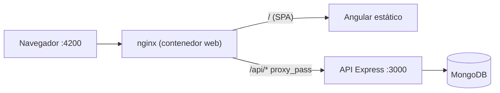
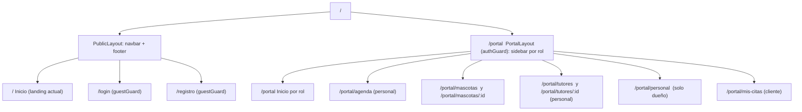
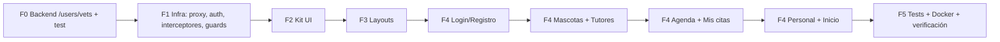

# Plan de desarrollo · Portal Clínico VetCare (Angular + Spartan UI)

## Objetivo

Construir el **portal clínico** dentro de la app Angular ya existente (`app/web`) usando **solo las funciones que ya tiene el backend**:

| Módulo backend | Endpoints existentes | Historia(s) |
|---|---|---|
| Auth (Better Auth) | `POST /api/auth/sign-in/email`, `POST /api/auth/sign-up/email`, `GET /api/auth/get-session`, `POST /api/auth/sign-out` | HU-02, HU-03, HU-04, HU-11 |
| Personal (`/api/users`, solo dueño) | `GET`, `POST`, `GET /:id`, `PATCH /:id` (incluye `active`) | HU-05, HU-06 |
| Tutores (`/api/clients`, personal) | `GET`, `POST`, `GET /:id` (incluye sus mascotas), `PATCH /:id` | HU-07, HU-12 |
| Mascotas (`/api/pets`) | `GET` (búsqueda, especie, tutor, paginación), `POST`, `GET /:id`, `PATCH /:id`, `DELETE /:id` (personal) | HU-08, HU-09, HU-10, HU-12 |
| Citas (`/api/appointments`) | `GET` (fecha, vet, mascota, estado), `POST`, `GET /:id`, `PATCH /:id`, `PATCH /:id/status`, `DELETE /:id` (dueño) | HU-13, HU-14, HU-15 |

Será **una sola app con layout por rol**: el personal (dueño / veterinario / auxiliar) y el cliente entran por el mismo login y cada uno ve solo su menú.

> [!NOTE]
> **Fuera de alcance:** historia clínica (HU-16/17), vacunas (HU-18/19) y dashboard con agregaciones (HU-24), porque todavía no existen en el backend. El portal deja preparados el menú y la ficha de mascota para agregarlos después.

---

## Revisión requerida

> [!IMPORTANT]
> **Único cambio en el backend:** un endpoint nuevo de solo lectura, `GET /api/users/vets`, para cualquier usuario autenticado. Devuelve solo `id` y `name` de los veterinarios activos. Hace falta para elegir veterinario al agendar, porque `GET /api/users` es solo para el dueño. No expone correo, teléfono ni documento.

> [!IMPORTANT]
> **Sesión basada en cookies, no en token.** Better Auth usa una cookie httpOnly, así que *no* guardamos tokens en `localStorage`. Un interceptor agrega `withCredentials: true` y, ante un 401, redirige a `/login`. Esto cumple la intención de HU-11 de forma más segura (OWASP A07).

> [!WARNING]
> **El backend y la matriz de roles no coinciden en un punto.** La matriz (`docs/02-roles-permisos.md`) dice que el cliente **no** crea ni edita mascotas. El backend actual **sí lo permite** (sobre sus propias mascotas, y hay un test que lo cubre). El plan **sigue la matriz en la interfaz**: el cliente ve sus mascotas en modo solo lectura. Si prefieres que el cliente pueda registrar sus mascotas, dímelo y activo el botón.

### Matriz que aplicará la interfaz

| Pantalla / acción | Dueño | Veterinario | Auxiliar | Cliente |
|---|:-:|:-:|:-:|:-:|
| Inicio del portal (resumen) | ✅ | ✅ (su agenda de hoy) | ✅ (agenda de hoy) | ✅ (sus próximas citas) |
| Agenda: ver / filtrar | ✅ | ✅ | ✅ | 🔒 Mis citas |
| Agenda: crear | ✅ | ✅ | ✅ | ✅ (solo sus mascotas)¹ |
| Agenda: reprogramar | ✅ | ✅ | ✅ | ❌ |
| Agenda: marcar atendida | ✅² | ✅ | ❌ | ❌ |
| Agenda: cancelar | ✅ | ✅ | ✅ | ✅ (sus citas) |
| Agenda: eliminar | ✅ | ❌ | ❌ | ❌ |
| Mascotas: listar, ver, crear, editar | ✅ | ✅ | ✅ | 🔒 solo lectura |
| Mascotas: eliminar | ✅ | ✅³ | ✅³ | ❌ |
| Tutores: listar, crear, editar, activar/desactivar | ✅ | ✅ | ✅ | ❌ |
| Personal: listar, crear, editar, desactivar | ✅ | ❌ | ❌ | ❌ |

¹ El backend ya lo permite, valida que la mascota sea suya y aplica la ventana de 30 min.
² El backend acepta que el dueño marque `done`. Si quieres seguir la matriz estricta (solo el veterinario), lo oculto para el dueño.
³ El backend permite eliminar mascotas a todo el personal (`authorize(...STAFF)`), aunque la matriz dice solo el dueño. La interfaz mostrará el botón **solo al dueño**.

---

## Arquitectura



- **Mismo origen:** el navegador solo habla con `localhost:4200`. nginx reenvía `/api/*` a `http://api:3000`, así la cookie de sesión funciona sin problemas de CORS ni de `SameSite`.
- **Desarrollo con `ng serve`:** `proxy.conf.json` hace lo mismo hacia `http://localhost:3000`.

### Rutas



---

## Cambios propuestos

### Fase 0 · Backend (cambio mínimo)

#### [MODIFY] user.router.js
Exponer `/vets` **antes** del `authorize(OWNER)` global:
```diff
 export const userRouter = Router();

-// Gestión del personal (vets y asistentes): solo el dueño
-userRouter.use(authenticate, authorize(ROLES.OWNER));
+userRouter.use(authenticate);
+
+// Lista mínima de veterinarios activos para agendar (cualquier usuario autenticado)
+userRouter.get('/vets', controller.listVets);
+
+// Gestión del personal (vets y asistentes): solo el dueño
+userRouter.use(authorize(ROLES.OWNER));
```

#### [MODIFY] user.service.js / user.controller.js
```js
export async function listActiveVets() {
  const vets = await User.find({ role: ROLES.VET, active: true }).select('name').sort({ name: 1 });
  return vets.map((v) => ({ id: v.id, name: v.name }));
}
// controller
export async function listVets(_req, res) { res.json({ items: await userService.listActiveVets() }); }
```

#### [NEW] tests/users-vets.test.js
- 401 sin sesión.
- El cliente recibe solo `{ id, name }` (sin `email`/`phone`).
- No incluye veterinarios inactivos ni otros roles.
- `GET /api/users` sigue devolviendo 403 a quien no sea dueño (prueba de regresión).

---

### Fase 1 · Infraestructura del frontend

#### [MODIFY] nginx.conf
```nginx
location /api/ {
  proxy_pass http://api:3000;
  proxy_http_version 1.1;
  proxy_set_header Host $host;
  proxy_set_header X-Forwarded-For $proxy_add_x_forwarded_for;
  proxy_set_header X-Forwarded-Proto $scheme;
}
```
(Va antes de `location /`. Se ajusta el regex de estáticos para que no capture `/api`.)

#### [NEW] proxy.conf.json + [MODIFY] angular.json
`"/api": { "target": "http://localhost:3000", "secure": false }` y `serve.options.proxyConfig`.

#### [MODIFY] docker-compose.yml
- `api.environment.BETTER_AUTH_URL: http://localhost:4200`: la URL pública es la del proxy.
- `CORS_ORIGIN` se mantiene en `http://localhost:4200` (también es `trustedOrigins` de Better Auth).

#### [MODIFY] app.config.ts
`provideHttpClient(withInterceptors([credentialsInterceptor, authErrorInterceptor]))`, `withComponentInputBinding()` en el router.

#### [NEW] `core/`
| Archivo | Responsabilidad |
|---|---|
| `core/models/*.ts` | Tipos: `User`, `Role`, `Pet`, `Client`, `Appointment`, `Paginated<T>` |
| `core/auth/auth.service.ts` | Signals `user()`, `role()`, `isStaff()`; `signIn`, `signUp`, `signOut`, `loadSession()` (vía `get-session`) |
| `core/auth/auth.guards.ts` | `authGuard`, `guestGuard`, `roleGuard(...roles)` (funcionales) |
| `core/http/credentials.interceptor.ts` | `withCredentials: true` en `/api` |
| `core/http/auth-error.interceptor.ts` | 401 → limpiar sesión y `router.navigate(['/login'], { queryParams: { returnUrl } })` |
| `core/api/*.service.ts` | `PetsApi`, `ClientsApi`, `StaffApi`, `AppointmentsApi` (un método por endpoint) |
| `core/ui/toast.service.ts` | Mensajes de éxito/error (el "snackbar" de HU-12) |
| `core/utils/api-error.ts` | Convierte `{ message, details }` del `errorHandler` en texto para formularios |

```ts
// auth.service.ts (extracto)
readonly user = signal<SessionUser | null>(null);
readonly role = computed(() => this.user()?.role ?? null);
readonly isStaff = computed(() => ['owner', 'vet', 'assistant'].includes(this.role() ?? ''));

loadSession() {
  return this.http.get<{ user: SessionUser } | null>('/api/auth/get-session')
    .pipe(tap((s) => this.user.set(s?.user ?? null)), catchError(() => of(null)));
}
```
La sesión se carga una vez al arrancar con `provideAppInitializer`, así los guards nunca ven un estado "desconocido".

---

### Fase 2 · Kit de UI (estilo Spartan, verde/blanco)

Siguiendo el patrón de los `hlm*` que ya existen (`button`, `badge`, `card`) y apoyándonos en las primitivas de `@spartan-ng/brain`, que ya está instalado:

#### [NEW] `shared/ui/`
`input`, `label`, `form-field` (label + error), `select` (nativo estilizado), `table`, `dialog` (brain dialog), `skeleton`, `empty-state` (con ilustración unDraw), `pagination`, `status-badge` (scheduled = azul, done = verde, cancelled = gris), `confirm-dialog`.

#### [NEW] `public/illustrations/`
2 o 3 SVG adicionales de unDraw (login, estado vacío, agenda), recoloreados a `#16a34a`.

---

### Fase 3 · Layouts

#### [MODIFY] app.html
Queda solo `<router-outlet />`. El navbar y el footer pasan al layout público.

#### [NEW] `layouts/public-layout.component.ts`
Navbar + footer actuales + `router-outlet`. El botón "Ingresar" del navbar apunta a `/login` (o a `/portal` si ya hay sesión).

#### [NEW] `layouts/portal-layout.component.ts`
- Sidebar (colapsable en móvil) generado desde una config por rol:
```ts
const MENU: MenuItem[] = [
  { label: 'Inicio',     icon: 'lucideLayoutDashboard', path: '/portal',           roles: ALL },
  { label: 'Agenda',     icon: 'lucideCalendar',        path: '/portal/agenda',    roles: STAFF },
  { label: 'Mascotas',   icon: 'lucidePawPrint',        path: '/portal/mascotas',  roles: ALL },   // "Mis mascotas" para cliente
  { label: 'Tutores',    icon: 'lucideUsers',           path: '/portal/tutores',   roles: STAFF },
  { label: 'Personal',   icon: 'lucideStethoscope',     path: '/portal/personal',  roles: ['owner'] },
  { label: 'Mis citas',  icon: 'lucideCalendarCheck',   path: '/portal/mis-citas', roles: ['client'] },
];
```
- Topbar: nombre, badge de rol en español (Dueño / Veterinario / Auxiliar / Tutor) y "Cerrar sesión".

---

### Fase 4 · Pantallas (`features/`)

#### Auth: `features/auth/`
- **[NEW] login.component**: formulario reactivo (correo, contraseña ≥ 8), mensaje genérico ante 401, respeta `returnUrl`. Ilustración unDraw a un lado.
- **[NEW] register.component**: nombre, correo, teléfono opcional, contraseña + confirmación. Un 409 muestra "El correo ya está registrado". Siempre crea un `client`, como garantiza el backend.

#### Inicio del portal: `features/dashboard/`
- **[NEW] dashboard.component**: tarjetas calculadas con los endpoints existentes, sin agregaciones nuevas:
  - Personal: citas de hoy (`GET /appointments?date=hoy`, `total`), pendientes de hoy (`status=scheduled`) y total de mascotas (`GET /pets?limit=1`, `total`). El veterinario ve *su* agenda de hoy (`vet=me`).
  - Cliente: sus mascotas y sus próximas citas.

#### Agenda: `features/appointments/` (HU-15)
- **[NEW] agenda.component**: selector de día (‹ hoy ›), filtro por veterinario (`/users/vets`) y por estado. Lista ordenada por hora con mascota, tutor, veterinario, motivo y `status-badge`. El veterinario arranca filtrado en sí mismo.
- **[NEW] appointment-form.dialog**: mascota (búsqueda contra `/pets?search=`), veterinario, fecha y hora (`datetime-local`, `min=ahora`) y motivo. Un 409 se muestra en el campo de hora: *"El veterinario ya tiene una cita en ese horario (ventana de 30 min)"*. Sirve para crear y reprogramar.
- Acciones por fila según la matriz: **Atender** (`done`), **Cancelar** (`cancelled`, con confirmación), **Reprogramar**, **Eliminar** (dueño).
- **[NEW] my-appointments.component** (cliente): próximas e historial, con botón "Agendar cita" que usa el mismo diálogo limitado a sus mascotas, y "Cancelar".

#### Mascotas: `features/pets/` (HU-12)
- **[NEW] pets-list.component**: tabla con búsqueda (debounce 300 ms), filtro de especie, paginación, estados de carga y vacío. Para el cliente el título es "Mis mascotas" y no hay botón de crear.
- **[NEW] pet-form.dialog**: nombre, especie, raza, sexo, fecha de nacimiento (≤ hoy), peso (≥ 0), notas y tutor (búsqueda en `/clients`, solo al crear y solo para el personal).
- **[NEW] pet-detail.component**: datos, tutor con su teléfono, próximas citas (`/appointments?pet=:id`) y botones de editar, agendar y eliminar. Deja una pestaña "Historia clínica · próximamente".

#### Tutores: `features/clients/` (HU-07, HU-12)
- **[NEW] clients-list.component**: búsqueda por nombre, correo, documento o teléfono; filtro activo/inactivo; paginación.
- **[NEW] client-form.dialog**: nombre, correo, teléfono, documento y contraseña temporal (con botón "Generar"). Al editar se oculta el correo y la contraseña, y aparece el switch "Activo".
- **[NEW] client-detail.component**: datos y sus mascotas (de `GET /clients/:id`), más "Registrar mascota" con el tutor ya elegido.

#### Personal: `features/staff/` (HU-05, HU-06)
- **[NEW] staff-list.component**: filtro de rol (vet/assistant) y estado.
- **[NEW] staff-form.dialog**: crear vet o auxiliar; editar nombre, rol, teléfono y documento; activar o desactivar con confirmación (desactivar cierra sus sesiones, lo hace el backend).

---

### Fase 5 · Pruebas y documentación

#### [NEW] Tests unitarios (Vitest, ya configurado)
- `auth.service.spec.ts`: `loadSession`, `signIn`, `signOut` y los signals de rol.
- `auth.guards.spec.ts`: `authGuard` redirige sin sesión; `roleGuard` bloquea al cliente en `/portal/personal`.
- `auth-error.interceptor.spec.ts`: un 401 navega a `/login` con `returnUrl`.
- `portal-layout.spec.ts`: el menú muestra solo las opciones del rol.

#### [MODIFY] app/README-DESPLIEGUE.md
Cómo entrar al portal, usuarios de prueba y el flujo dev (`ng serve` con proxy).

---

## Orden de ejecución



Cada fase termina con `ng build` en verde antes de pasar a la siguiente.

---

## Plan de verificación

### Pruebas automáticas
```powershell
# Backend: suite completa (54 actuales + las nuevas de /users/vets)
cd app/api; node --experimental-vm-modules node_modules/jest/bin/jest.js --runInBand

# Frontend: build de producción y tests unitarios
cd app/web; npx ng build; npx ng test --watch=false

# Stack completo
cd app; docker compose up -d --build; docker compose exec api npm run seed
```

### Verificación manual (con el subagente de navegador sobre http://localhost:4200)
1. **Dueño** (`owner@vetcare.dev`): login → crear un veterinario y un auxiliar en *Personal* → crear un tutor → crear una mascota → agendar una cita.
2. Agendar otra cita con el mismo veterinario 15 min después → se ve el error 409 en el formulario.
3. **Auxiliar**: el botón "Atender" no aparece; puede cancelar. *Personal* no está en el menú y `/portal/personal` redirige.
4. **Veterinario**: la agenda arranca filtrada en él; marca la cita como atendida.
5. **Cliente** (registro público): solo ve sus mascotas y citas; agenda una cita para su mascota y la cancela.
6. Cerrar sesión, o borrar la cookie y recargar `/portal/agenda` → redirige a `/login?returnUrl=…`.
7. Revisar en móvil (375 px) que el sidebar colapse.
