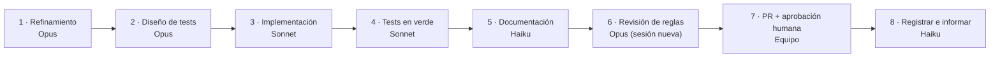

# 10 · Plan de trabajo para finalizar VetCare (Scrum + modelos de IA)

> **Punto de partida (20 de noviembre de 2026):** ≈ 41 de 98 SP hechos (≈ 42 %). Faltan ≈ 57 SP.
> **Meta:** terminar el backlog en 3 sprints (Sprint 2, 3 y 4) y llegar a la clase 6 con la demo, el CI en verde y la URL pública.

Este plan sigue el marco de [`07-scrum.md`](./07-scrum.md) (sprints semanales, DoR, DoD, límite WIP, review y retro). Le suma dos cosas:

1. **Qué modelo de IA se usa en cada etapa** (Opus, Sonnet o Haiku).
2. **Pruebas de validación automáticas** que comprueban las reglas de negocio ([`02-roles-permisos.md`](./02-roles-permisos.md)) y las reglas de diseño ([`app/web/AGENTS.md`](../app/web/AGENTS.md)) antes de que una historia pase a **Done**.

---

## 1. Qué modelo se usa y para qué

| Modelo | Fortaleza | Se usa para | No se usa para |
|---|---|---|---|
| **Opus** | Razonamiento profundo, seguridad, visión de conjunto | Decisiones de arquitectura y ADRs; diseño de reglas de negocio y de la matriz de permisos; diseño de los tests de validación; código sensible (autenticación, permisos, propiedad de datos); **revisión final** de cada historia | Tareas mecánicas o repetitivas |
| **Sonnet** | Buen equilibrio entre calidad y velocidad | Implementar endpoints, servicios, pantallas Angular, directivas `hlm*` y escribir los tests ya diseñados | Decidir reglas de negocio o aprobar su propio trabajo |
| **Haiku** | Rápido y barato | Actualizar documentación, `backlog.json`, traducciones de `labels.ts`, YAML simple, datos de seed, ejecutar suites y resumir resultados, dailies y burndown | Lógica de negocio, seguridad o revisión |

### Reglas de uso

- **Quien implementa no se aprueba a sí mismo.** La revisión final la hace **Opus en una sesión nueva**, que no vio la implementación, con la checklist de la sección 4.
- **Si Sonnet falla dos veces** en la misma tarea (tests rojos después de dos intentos), se escala a Opus.
- **Si una tarea de Haiku toca lógica**, se reasigna a Sonnet.
- Todo cambio generado por IA entra por **Pull Request** y lo aprueba **un integrante humano** (DoD).
- **Cada tarea terminada se registra y se informa** (ver la sección 7). Lo hace Haiku (`vetcare-docs`) en cuanto la tarea pasa la puerta G8.

### Cómo se cambia de modelo en Claude Code

- En la sesión: `/model opus`, `/model sonnet` o `/model haiku`.
- Con subagentes fijos en `.claude/agents/` (cada uno declara su `model:` en el frontmatter):

| Subagente | Modelo | Rol |
|---|---|---|
| `vetcare-arquitecto` | opus | Diseña la historia, sus reglas y los tests de validación |
| `vetcare-dev` | sonnet | Implementa y escribe los tests diseñados |
| `vetcare-docs` | haiku | Actualiza `docs/`, backlog y textos |
| `vetcare-revisor` | opus | Revisa la historia contra las reglas y la DoD, sin haber visto la implementación |

---

## 2. Flujo de una historia (etapas y modelo por etapa)



| Etapa | Modelo | Entrada | Salida |
|---|---|---|---|
| 1 · Refinamiento | Opus | Historia del backlog + docs 02, 05, 06 | Criterios ajustados al código real y lista de reglas RN/RD que toca |
| 2 · Diseño de tests | Opus | Reglas RN/RD de la historia | Tests en rojo (TDD): casos felices, permisos por rol y casos de error |
| 3 · Implementación | Sonnet | Tests en rojo + `AGENTS.md` | Código que cumple la estructura por módulos y las convenciones Angular |
| 4 · Tests en verde | Sonnet | Suite completa | `npm run lint`, `npm test`, `ng build` y `ng test` sin errores |
| 5 · Documentación | Haiku | Diff del PR | `06-api.md`, `05-modelo-datos.md`, `backlog.json` y `03` actualizados |
| 6 · Revisión | Opus | PR + checklist de la sección 4 | Aprobado, o lista de cambios con la regla incumplida |
| 7 · PR | Humano | Revisión de Opus | Merge a `develop` |
| 8 · Registrar e informar | Haiku | Merge + aceptación del PO | Fila nueva en la bitácora (sección 7), `% avance` actualizado y aviso al equipo |

---

## 3. Reglas que se validan con tests

### 3.1 Reglas de negocio (RN)

| ID | Regla | Fuente | Test que la valida |
|---|---|---|---|
| RN-01 | Un cliente nunca ve datos de otro cliente (mascotas, citas, historias, vacunas) | 02 · regla 1 | `api/tests/ownership.test.js` |
| RN-02 | Cada rol solo hace lo que permite la matriz de permisos | 02 · matriz | `api/tests/permissions.matrix.test.js` (lee `docs/permisos.json`) |
| RN-03 | El veterinario de una consulta se toma de la sesión, nunca del body | 02 · regla 2 | `api/tests/records.test.js` |
| RN-04 | El registro público siempre crea `client`, aunque envíen `role` | 02 · regla 3 | `api/tests/auth.test.js` |
| RN-05 | El personal no se borra, se desactiva; al desactivarlo se cierran sus sesiones | 02 · regla 4 | `api/tests/users.test.js` |
| RN-06 | Un usuario desactivado no puede iniciar sesión ni usar una sesión abierta | 02 · regla 5 | `api/tests/auth.test.js` |
| RN-07 | Sin sesión → 401; rol sin permiso → 403; id inválido → 400; inexistente → 404 | 06 · convenciones | `permissions.matrix.test.js` + tests por módulo |
| RN-08 | Una cita no puede estar en el pasado | HU-13 | `api/tests/appointments.test.js` |
| RN-09 | Dos citas del mismo veterinario con menos de 30 min de diferencia → 409 | HU-13 | `api/tests/appointments.test.js` |
| RN-10 | Solo el veterinario (y el dueño, según la decisión D-02) marca una cita como atendida | HU-14 | `api/tests/appointments.test.js` |
| RN-11 | Registrar una consulta desde una cita la deja en `done` | HU-16 | `api/tests/records.test.js` |
| RN-12 | La historia clínica se ordena de la más reciente a la más antigua e incluye el nombre del veterinario | HU-17 | `api/tests/records.test.js` |
| RN-13 | `nextDueDate` debe ser posterior a `appliedAt` | HU-18 | `api/tests/vaccinations.test.js` |
| RN-14 | `GET /api/vaccinations/due?days=30` devuelve mascota y teléfono del tutor, y usa el índice `nextDueDate` | HU-19 | `api/tests/vaccinations.test.js` (incluye `explain()`) |
| RN-15 | El filtro `?date=` de citas usa el día en hora de Colombia (America/Bogota), no en UTC | HU-14 | `api/tests/appointments.test.js` |
| RN-16 | La contraseña nunca aparece en una respuesta | HU-02 | `api/tests/no-password-leak.test.js` (recorre todos los endpoints) |
| RN-17 | La mascota solo se asocia a un tutor `client` activo | HU-08 | `api/tests/pets.test.js` |

> **Una sola fuente de verdad para los permisos.** La matriz de `02-roles-permisos.md` se pasa también a `docs/permisos.json` (rol × endpoint → código esperado). El test `permissions.matrix.test.js` recorre ese archivo y la interfaz construye su menú con la misma información. Si alguien cambia la matriz, el test lo detecta.

### 3.2 Reglas de diseño (RD)

| ID | Regla (resumen de `AGENTS.md`) | Sección | Cómo se valida |
|---|---|---|---|
| RD-01 | Solo clases `emerald-*` para la marca; nada de `green-*` ni hex en plantillas | §2 | `web/scripts/check-design.mjs` |
| RD-02 | Una sola acción primaria (`hlmBtn` `default`) por vista o diálogo | §5 | `check-design.mjs` + revisión de Opus |
| RD-03 | Acciones destructivas con `destructive` y diálogo de confirmación | §5 | Test de componente (Vitest) + e2e |
| RD-04 | Botones de solo icono con `aria-label` | §5, §10 | `check-design.mjs` + axe en Playwright |
| RD-05 | Labels asociados con `for`/`id`; errores bajo el campo | §5 | axe en Playwright |
| RD-06 | Estados de carga (skeleton), vacío (unDraw) y error ("Reintentar") en cada vista con datos | §7 | Tests de componente con la API simulada |
| RD-07 | Ningún valor técnico (`scheduled`, `owner`, `dog`, `M`) visible en la interfaz | §1, §9 | e2e: busca esas palabras en el texto de cada página |
| RD-08 | Traducciones solo en `core/i18n/labels.ts` | §9 | `check-design.mjs` + test unitario de `labels.ts` |
| RD-09 | El menú muestra solo lo que el rol puede hacer | §6 | Test de `portal-layout` por rol (usa `permisos.json`) |
| RD-10 | Funciona a 375 px y a 1280 px; el sidebar se vuelve drawer | §10 | Playwright con los dos viewports + capturas |
| RD-11 | Contraste AA y foco visible | §10 | axe en Playwright (sin violaciones serias) |
| RD-12 | Componentes standalone, OnPush, `inject()`, signals y control flow nuevo | §11 | ESLint de Angular (`@angular-eslint`) |
| RD-13 | HTTP solo desde `core/api/`, nunca desde componentes | §11 | `check-design.mjs` |
| RD-14 | Sin `shadow-2xl`, blobs ni `-translate-y-1` en el portal | §4, §6 | `check-design.mjs` |
| RD-15 | Fechas en locale `es-CO` con los formatos definidos | §9 | Test unitario de los pipes |
| RD-16 | `ng build` sin errores ni advertencias de presupuesto | §12 | CI |

### 3.3 Herramientas nuevas para validar

| Herramienta | Dónde | Para qué |
|---|---|---|
| `docs/permisos.json` | docs | Matriz legible por máquina (RN-02, RD-09) |
| `app/web/scripts/check-design.mjs` | web | Revisa las plantillas en busca de incumplimientos de RD-01, 02, 04, 08, 13 y 14 |
| `@playwright/test` + `@axe-core/playwright` | web | e2e, accesibilidad, viewports y búsqueda de valores sin traducir |
| `@angular-eslint` | web | Convenciones de Angular (RD-12) |
| Cobertura de Jest (`--coverage`) | api | Umbral mínimo del 60 % (HU-20) |
| `.github/workflows/ci.yml` | raíz | Ejecuta todo lo anterior en cada push y PR |

---

## 4. Definition of Done ampliada

Una historia está en **Done** cuando, además de la DoD de `07-scrum.md`, pasa estas puertas en orden:

| Puerta | Qué se comprueba | Quién la ejecuta |
|---|---|---|
| G1 · Lint | `npm run lint` (api) y `ng lint` (web) | CI |
| G2 · Tests unitarios | Vitest (web) y servicios (api) | CI |
| G3 · Integración y permisos | Jest + supertest, incluida `permissions.matrix.test.js` | CI |
| G4 · Diseño | `node scripts/check-design.mjs` sin errores | CI |
| G5 · e2e y accesibilidad | Playwright + axe a 375 y 1280 px (desde el Sprint 3) | CI |
| G6 · Revisión de reglas | Opus en sesión nueva revisa el PR contra las RN y RD de la historia y la checklist §12 de `AGENTS.md` | `vetcare-revisor` |
| G7 · Aprobación humana | Al menos 1 compañero aprueba el PR | Equipo |
| G8 · Aceptación del PO | Se muestra en vivo en la review | Docente |
| G9 · Registro y aviso | La tarea aparece en la bitácora de la sección 7 y se informó que está terminada | `vetcare-docs` (Haiku) |

> **Una tarea sin registro y sin aviso no está terminada**, aunque el código ya esté en `develop`.

---

## 5. Decisiones previas (aprobadas)

La documentación y el código no coincidían en algunos permisos. El **Product Owner** aprobó estas decisiones el 20 de noviembre de 2026 (tarea 2.1): Opus preparó las opciones y `permisos.json`, y Haiku actualizó los documentos. El backend se ajusta en la tarea 2.4.

| ID | Tema | Hoy en el código | Hoy en la matriz | Decisión del PO (20 nov 2026) |
|---|---|---|---|---|
| D-01 | Cliente crea o edita sus mascotas | Permitido | No | ✅ Aprobada: **Seguir la matriz**: solo lectura, como dice la visión ("portal del cliente solo lectura"). Ajustar el backend |
| D-02 | Dueño marca cita como atendida | Permitido | No | ✅ Aprobada: **Permitirlo**: la visión dice que el dueño "a veces también atiende". Actualizar la matriz |
| D-03 | Eliminar mascota | Todo el personal | Solo dueño | ✅ Aprobada: **Solo dueño**, como la matriz y HU-10. Ajustar el backend |
| D-04 | Cliente agenda o cancela sus citas | Permitido | No | ✅ Aprobada: **Seguir la matriz** para el MVP (solo lectura). Pasar a la versión 2 |
| D-05 | Veterinario y auxiliar listan al personal | No | Sí (lectura) | ✅ Aprobada: Crear `GET /api/users/vets` (id y nombre), como propone el plan 09, y anotarlo así en la matriz |
| D-06 | Cliente edita su perfil | No existe | Sí | ✅ Aprobada: **Sacarlo del MVP** y marcarlo ❌ en la matriz |

> Si el PO decide algo distinto, solo cambia `docs/permisos.json`; los tests y el menú se ajustan solos.

---

## 6. Sprints

Velocidad esperada: 15 a 25 SP por sprint (ver `07-scrum.md`). Límite WIP: 1 historia por persona.

### Sprint 2 · Base del portal, CI y agenda · ≈ 21 SP

**Objetivo:** un auxiliar inicia sesión, registra un tutor y una mascota y agenda una cita desde la interfaz, con el CI en verde.

| # | Tarea | HU | SP | Etapas y modelo | Validación |
|---|---|---|:-:|---|---|
| 2.1 | Decidir D-01 a D-06 y crear `docs/permisos.json` | — | — | Opus (opciones) · PO (decide) · Haiku (docs) | Revisión del PO |
| 2.2 | Pipeline de CI (lint, tests, build) y badge en un README raíz | T-04 | 2 | Haiku (YAML) · Opus (revisión) | El CI falla a propósito con un test roto y pasa al arreglarlo |
| 2.3 | Tablero en GitHub Projects con el backlog restante | T-05 | 1 | Haiku (carga desde `backlog.json`) | Revisión del Scrum Master |
| 2.4 | Ajustes de backend: HU-09 (datos del tutor), HU-10 (D-03), HU-07 (contraseña temporal), D-01, D-04 y `GET /api/users/vets` | HU-07, 09, 10 | 3 | Opus (tests) · Sonnet (código) · Opus (revisión) | RN-01, RN-02, RN-07, RN-17 |
| 2.5 | Corregir la fecha de la agenda a hora de Colombia | HU-14 | — | Sonnet · Opus (revisión) | RN-15 |
| 2.6 | `permissions.matrix.test.js` y `no-password-leak.test.js` | HU-20 | — | Opus (diseño) · Sonnet (código) | RN-02, RN-07, RN-16 |
| 2.7 | Infraestructura web: proxy, `AuthService`, interceptores, guards y `labels.ts` (plan 09, fases 0 y 1) | HU-11 | 5 | Opus (auth y guards) · Sonnet (resto) | RD-08, RD-09, tests de guards e interceptor |
| 2.8 | Kit de UI `hlm*` y layouts público y portal (plan 09, fases 2 y 3), con `check-design.mjs` | HU-11 | (en 2.7) | Sonnet · Haiku (traducciones) · Opus (revisión de diseño) | RD-01 a RD-06, RD-12 a RD-14 |
| 2.9 | Pantallas de tutores y mascotas | HU-12 | 5 | Sonnet · Opus (revisión) | RD-02 a RD-07, RD-09 |
| 2.10 | Pantalla de agenda (crear, reprogramar, atender, cancelar) | HU-15 | 5 | Sonnet · Opus (revisión) | RN-08 a RN-10, RD-03, RD-06, RD-07 |
| 2.11 | ADR-0004 (Argon2id) y actualizar 04, 05 y 06 | — | — | Opus (ADR) · Haiku (docs) | Revisión del equipo |
| 2.12 | Lint de Angular con `@angular-eslint` (script `lint` en web y paso en el CI) | T-04 | — | Sonnet (configuración) · Opus (revisión) | G1, RD-12 |

**Ceremonias:** planning con Opus para dividir tareas · dailies resumidas con Haiku · review con la verificación manual del plan 09 · retro *Start / Stop / Continue*.

### Sprint 3 · Historia clínica, vacunas y calidad · ≈ 23 SP

**Objetivo:** el veterinario registra consultas y vacunas desde la ficha de la mascota, y el CI corre tests unitarios, de integración, e2e y de accesibilidad.

| # | Tarea | HU | SP | Etapas y modelo | Validación |
|---|---|---|:-:|---|---|
| 3.1 | Modelo y API de consultas (`/api/pets/:id/records`), cierre de la cita en la misma operación | HU-16 | 5 | Opus (diseño del modelo y la transacción) · Sonnet (código) · Opus (revisión) | RN-01, RN-03, RN-11 |
| 3.2 | Línea de tiempo de la historia clínica en la ficha | HU-17 | 3 | Sonnet · Opus (revisión) | RN-12, RD-06, RD-15 |
| 3.3 | Modelo y API de vacunas, formulario y lista en la ficha | HU-18 | 3 | Sonnet · Opus (revisión) | RN-01, RN-13, RD-05 |
| 3.4 | Vacunas por vencer (`/api/vaccinations/due`) y tabla | HU-19 | 3 | Sonnet · Opus (revisión del índice) | RN-14 |
| 3.5 | Cobertura ≥ 60 % en la API y tests unitarios de Angular | HU-20 | 3 | Opus (qué falta cubrir) · Sonnet (tests) · Haiku (reporte) | Umbral de cobertura en el CI |
| 3.6 | e2e con Playwright: login → mascota → cita → consulta, por cada rol, con axe y dos viewports | HU-21 | 5 | Opus (escenarios) · Sonnet (código) | RD-04, RD-05, RD-07, RD-10, RD-11 |
| 3.7 | Checklist OWASP: `npm audit`, validación zod en todos los endpoints, secretos | HU-22 | 1 | Opus (auditoría) · Haiku (informe) | Sin vulnerabilidades altas |
| 3.8 | Actualizar 05, 06 y backlog | — | — | Haiku | Revisión del equipo |

### Sprint 4 · Producción, portal y dashboard · ≈ 14 SP

**Objetivo:** VetCare está desplegado con URL pública, el tutor ve su portal y hay métricas y logs.

| # | Tarea | HU | SP | Etapas y modelo | Validación |
|---|---|---|:-:|---|---|
| 4.1 | Portal del cliente: mis mascotas, próximas citas, vacunas e historia en solo lectura | HU-23 | 3 | Sonnet · Opus (revisión de propiedad de datos) | RN-01, RD-09, e2e con dos clientes distintos |
| 4.2 | Dashboard por rol con aggregation pipeline | HU-24 | 3 | Opus (pipeline) · Sonnet (UI) | RN-02, RD-06 |
| 4.3 | Revisar Dockerfiles (multi-stage, usuario no root) | HU-25 | 1 | Haiku · Opus (revisión de seguridad) | `docker compose up` levanta todo |
| 4.4 | Atlas + Railway con CD desde `main` y secretos en la plataforma | HU-26 | 5 | Opus (configuración de cookies cross-site y CORS) · Sonnet · Haiku (README) | e2e contra la URL pública |
| 4.5 | `/metrics` con prom-client y logs JSON con pino | HU-27 | 2 | Sonnet · Haiku (docs) | Test de `/metrics` |
| 4.6 | Documentación final y guion de la demo | — | — | Haiku · Opus (revisión) | Ensayo de la demo |

### Clase 6 · Demo y defensa

- Opus prepara con cada estudiante las preguntas de la defensa (`08-rubrica.md`) sobre **su** historia.
- Haiku genera el resumen del proyecto para el portafolio.
- El equipo ensaya la demo con el seed de demostración.

---

## 7. Registro de tareas terminadas

### Regla

**Cada vez que se termina una tarea o historia, se deja constancia en la documentación y se informa al equipo que quedó terminada.** Es la puerta G9 de la DoD.

Cuando una tarea pasa la puerta G8, Haiku (`vetcare-docs`) hace en el mismo PR o en uno inmediato:

1. **Agrega una fila** a la bitácora de abajo: fecha, tarea, HU, SP, PR, modelos usados y reglas validadas.
2. **Marca la historia como terminada** en `backlog.json` (`"status": "done"`) y regenera `03-historias-usuario.md`, donde los criterios cumplidos pasan de `- [ ]` a `- [x]`.
3. **Actualiza** los SP pendientes y el `% avance` del burndown.
4. **Actualiza** la documentación técnica afectada (`05-modelo-datos.md`, `06-api.md`, ADR) si cambió la API o el modelo.
5. **Informa que la tarea fue terminada:**
   - Comentario en el issue de la historia y cierre del issue.
   - Mover la tarjeta a **Done** en el tablero.
   - Mensaje en el canal del equipo con este formato:

```text
✅ Tarea terminada: 2.9 · Pantallas de tutores y mascotas (HU-12 · 5 SP)
PR: #42 · Modelos: Sonnet (código) · Opus (revisión)
Reglas validadas: RD-02 a RD-07, RD-09
Avance del proyecto: 58 % · Pendiente: 41 SP
```

### Bitácora

| Fecha | # | Tarea | HU | SP | PR | Modelos | Reglas validadas | Informado |
|---|---|---|---|:-:|---|---|---|:-:|
| 2026-11-20 | 2.1 | Decisiones D-01 a D-06 y `docs/permisos.json` | — | — | Sin PR (cambio local, pendiente de subir) | Opus (opciones y permisos.json) · PO (decide) · Haiku (docs) · Opus (revisión) | RN-02, RD-09 (fuente de verdad) | ✅ |
| 2026-11-20 | 2.2 | **En curso.** CI con lint y tests (`.github/workflows/ci.yml`), README raíz con badge, 2 correcciones de lint en la API y lockfile de la web regenerado | T-04 | 2 | Sin PR (pendiente de subir) | Haiku (YAML, README y correcciones de lint: debió pasar a Sonnet por tocar código) · Opus (revisión G6: rechazada el 20 nov) · Opus (correcciones de la revisión) | Comprobado aquí: lint de la API, build y tests de la web, verificación de RD-16. Falta en GitHub: los dos jobs en verde y la prueba del test roto | ⏳ No informada: faltan G6 sobre el PR, G7 y G8 |

## 8. Seguimiento (burndown)

| Corte | SP pendientes previstos | SP pendientes reales | % avance |
|---|:-:|:-:|:-:|
| Inicio (20 nov) | 57 | 57 | 42 % |
| Fin Sprint 2 | 36 | | |
| Fin Sprint 3 | 13 | | |
| Fin Sprint 4 | 0 | | 100 % |

Haiku actualiza esta tabla cada vez que se registra una tarea terminada (sección 7) y la revisa al cierre de cada sprint con los datos del tablero.

---

## 9. Riesgos

| Riesgo | Impacto | Mitigación |
|---|---|---|
| El PO tarda en decidir D-01 a D-06 | Bloquea la matriz, los tests y el menú | Decidir en la primera planning; si no hay respuesta, aplicar las recomendaciones |
| Cookies en producción con web y API en dominios distintos | El login no funciona en Railway | Servir la web y la API bajo el mismo dominio (proxy), como en local; Opus revisa `sameSite` y `secure` |
| MongoDB sin replica set (sin transacciones) | Consulta creada sin cerrar la cita | Atlas sí tiene replica set; en local, aceptar el riesgo (ADR-0001) |
| El frontend es lo más grande y empieza tarde | No llegar al S2 | Empezar 2.7 y 2.8 el primer día del sprint, en paralelo con el CI |
| La IA genera código que no sigue las reglas | Retrabajo | Tests escritos antes del código (etapa 2), `check-design.mjs` y revisión de Opus en sesión nueva |
